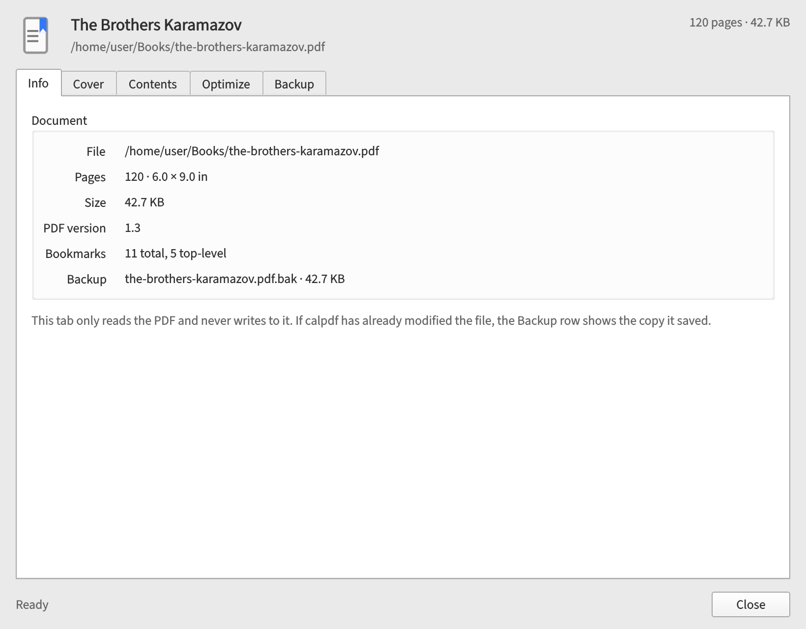
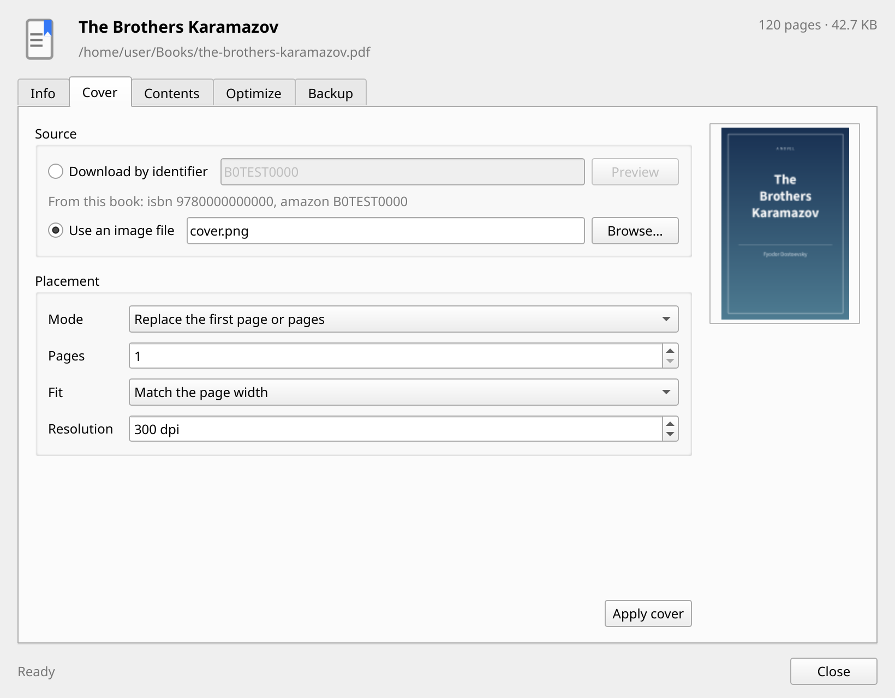
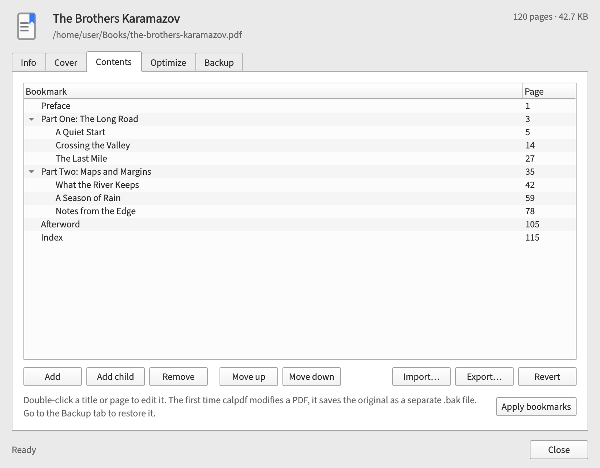
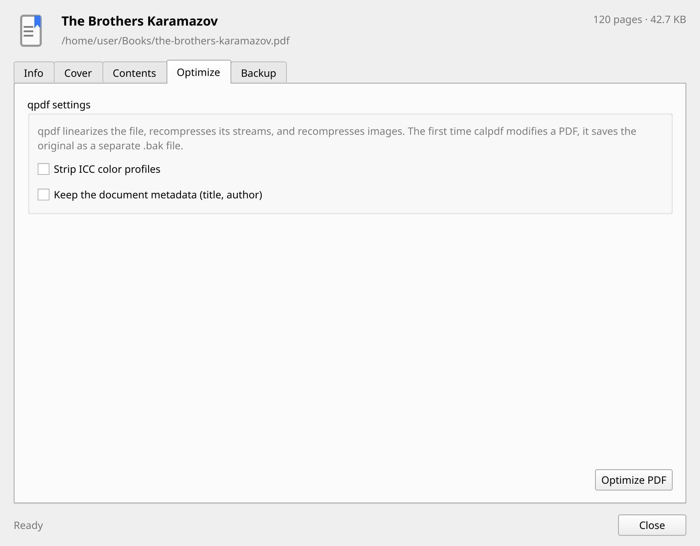

<div align="center">


# CalPDF for Calibre

</div>

Hi. CalPDF is a Calibre plugin for [`calpdf`](https://github.com/athaurian/calpdf). (The names are similar because both share the same code.)

It lets you inspect PDFs, swap covers, edit bookmarks, optimize file size with `qpdf`, and restore backups with a GUI.

## Tabs

### Info



Displays read-only document metadata: page count, page dimensions, file size, PDF version, bookmark count, and whether a `.bak` backup exists.

### Cover



Replaces cover pages or prepends a new one using a local PNG/JPEG or an image fetched by ASIN, ISBN, or Open Library ID.

| Control        | Behavior                                                                                                                                                                                                                                                                            |
| :------------- | :---------------------------------------------------------------------------------------------------------------------------------------------------------------------------------------------------------------------------------------------------------------------------------- |
| **Mode**       | **Replace first page(s)** removes the first `1–50` pages (and any bookmarks or internal links pointing to them) before inserting the cover. **Prepend as new page 1** keeps every existing page intact.                                                                             |
| **Fit**        | **Match width** scales the image to the target page width and adjusts the page height to match the image's aspect ratio. **Fill and crop** fills the target page dimensions and crops overflowing edges. **Fit inside** centers the full image inside the target page with margins. |
| **Resolution** | Sets the rendering DPI (`72–1200`, default `300`), used to size the page when no surviving reference page exists.                                                                                                                                                                   |

### Contents



Edits the PDF's table of contents (bookmark tree) directly or imports and exports them as JSON as `calpdf` would. For more information about the JSON schema, see [ToC JSON format](https://athaurian.github.io/calpdf/reference/toc-json-format/).

### Optimize



Runs stream compression and linearization using `qpdf`.

- **Metadata and accessibility tags:** By default, optimization strips document metadata (such as title and author) and the document structure tree (accessibility tags). Checking **Keep the document metadata** preserves metadata fields, but the structure tree is always removed.
- **Strip ICC color profiles:** Removes embedded `OutputIntents` and `ICCBased` color spaces to save space when exact color reproduction is unnecessary.
- **Small files:** Very small PDFs can grow slightly after optimization because `qpdf` adds linearization tables.

### Backup

The plugin shares the same `book.pdf.bak` file as the `calpdf` CLI.

- A backup is created once, right before the first in-place modification.
- While `book.pdf.bak` exists, subsequent in-place operations read from `.bak` as their source so they always work against the original file rather than compounding edits. To lock in your current PDF as the new baseline before running another tool, delete the backup first.
- Restoring copies `book.pdf.bak` back over `book.pdf` and deletes `.bak`.

## Requirements

- **Linux only:** Unfortunately, Windows and macOS builds of Calibre bundle a private Python runtime without a supported way to install third-party packages into it.
- **Calibre 6+**
- **`qpdf`** on `PATH` (for the **Optimize** tab)
- **`calpdf` 0.2+ installed in Calibre's Python environment:** Do not install `calpdf` with `uv tool install` if you want to use this plugin. `uv tool install` isolates `calpdf` inside its own virtual environment where Calibre cannot import it. Install `calpdf` into the system Python that Calibre uses (on Arch Linux, install `calpdf-git` from the Forge repository).

## Installation

```bash
git clone https://github.com/athaurian/calibre-calpdf.git
cd calibre-calpdf
make build
calibre-customize -a dist/calpdf.zip
```

To remove the plugin:

```bash
make uninstall
```

## Development

`make test` expects a sibling checkout of `calpdf` at `../calpdf/src` (override with `CALPDF_SRC=/path/to/calpdf/src`).

```bash
make venv   # create local test virtualenv
make test   # run test suite
make lint   # run Ruff checks
make ui     # render docs/screenshots/*.png
```

## License

MIT
