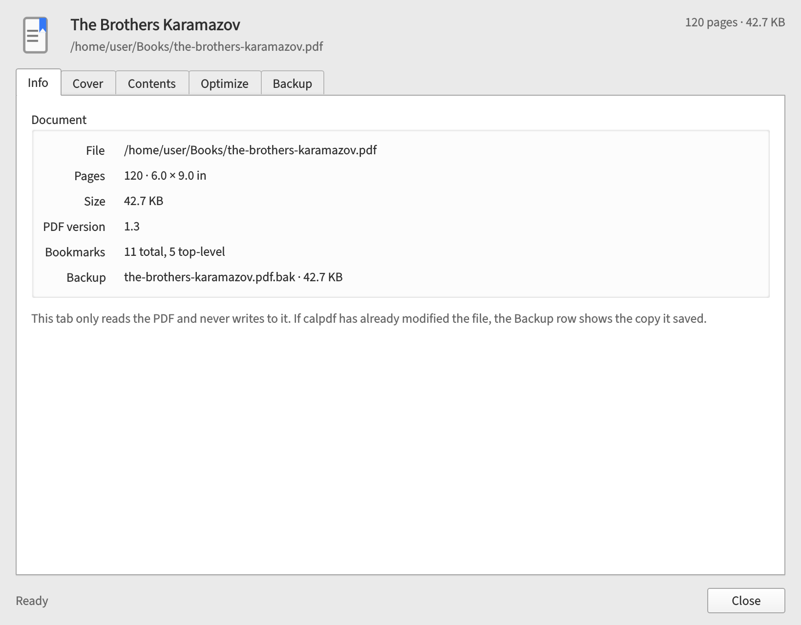
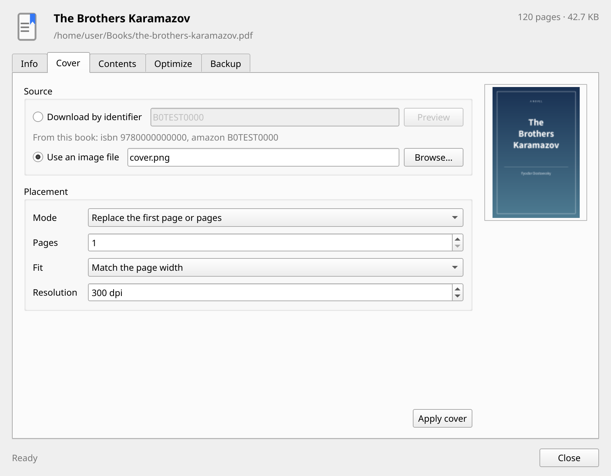
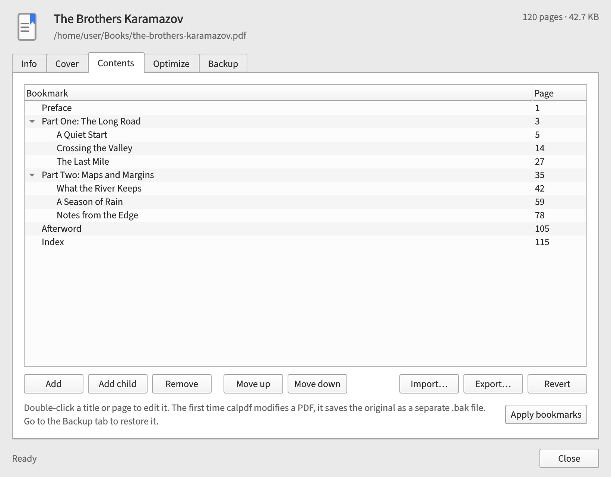

<div align="center">


# CalPDF

</div>

Hi. CalPDF puts [calpdf](https://github.com/athaurian/calpdf) inside Calibre.
You can replace covers, edit bookmarks, run `qpdf`, and restore backups,
exactly as you would on the command line.

It delegates all PDF handling to calpdf's code.

## Tabs

<p align="center">
  
</p>

The **Info** tab shows the page count, page size, file size, PDF version,
bookmark count, and whether a backup exists. Nothing on this tab changes the
file.

---

<p align="center">
  
</p>

The **Cover** tab downloads a cover by ASIN, ISBN, or Open Library ID (OLID), or
picks an image from disk. The image can replace the first page or several pages,
or prepend a new cover page. You can preview it before you apply it. Downloading
a cover needs a network connection.

---

<p align="center">
  
</p>

The **Contents** tab shows the PDF's bookmarks as a tree. You can rename a
title, change its page, add or remove entries, and move them up or down. Import
and export use the same JSON format as the `calpdf export-toc` and
`calpdf apply-toc` commands.

---

The **Optimize** tab compresses the PDF with `qpdf`. It has two options, both
off by default: **Strip ICC color profiles** and **Keep the document metadata**.
The second option keeps the title and author, which the default removes.
Optimizing usually makes a PDF smaller, but a file that is already well
optimized can grow a little because `qpdf` adds linearization data.

The **Backup** tab shows the `.bak` copy and restores it.

## Backup behavior

The first time calpdf changes a PDF, it saves a `.bak` copy next to the file and
leaves that copy alone after that. A cover, a bookmark edit, and an optimization
all share the one backup. **Restore from backup** puts the copy back over the
PDF and deletes it, the same way `calpdf restore` does.

If you close the dialog without applying anything, the PDF is untouched.

## Requirements

- Calibre 6 or newer.
- [calpdf](https://github.com/athaurian/calpdf) 0.2 or newer, installed where
  Calibre can import it. If the import or version check fails, the plugin shows
  an error that explains the problem.
- `qpdf` on `PATH` for the Optimize tab.

Calibre imports calpdf from the Python installation it runs on, so installing
calpdf using `uv tool install` won't help. On Arch, you can install
`calpdf-git` from my
[Forge repository](https://github.com/athaurian/forge), and it goes into the
system Python that Calibre uses. Elsewhere, install calpdf into the same Python
installation.

I use CalPDF on Linux. On Windows and macOS, Calibre bundles its own Python,
and I haven't covered how to install calpdf into it yet.

## Install

```sh
git clone https://github.com/athaurian/calibre-calpdf.git
cd calibre-calpdf
make build
calibre-customize -a dist/calpdf.zip
```

Restart Calibre, then add the **CalPDF** button from
_Preferences → Interface → Toolbars & menus_. You can set a shortcut under
_Preferences → Shortcuts_.

To remove the plugin:

```sh
make uninstall
```

## Development

```sh
make venv     # reuses the system pikepdf and Qt
make test
make lint
make ui       # renders docs/screenshots/*.png offscreen
```

The tests run against the checkout at `../calpdf/src`, not whatever copy of
calpdf you have installed. Point `CALPDF_SRC` elsewhere if your checkouts are
arranged differently.

`make build` produces `dist/calpdf.zip`, which Calibre loads as
`calibre_plugins.calpdf`.

## License

Released under the MIT license. See [LICENSE](LICENSE) for the full text.
