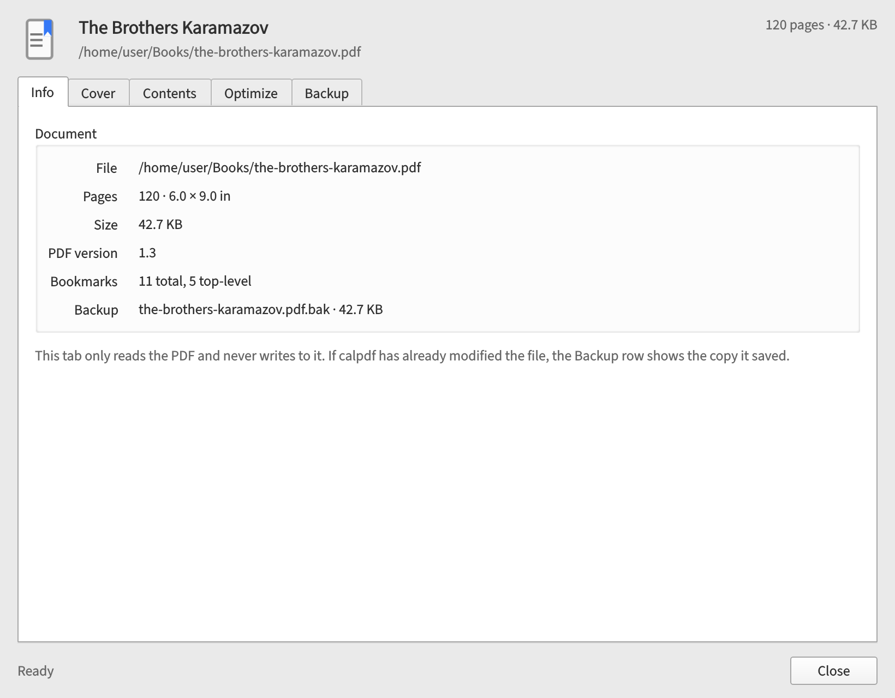
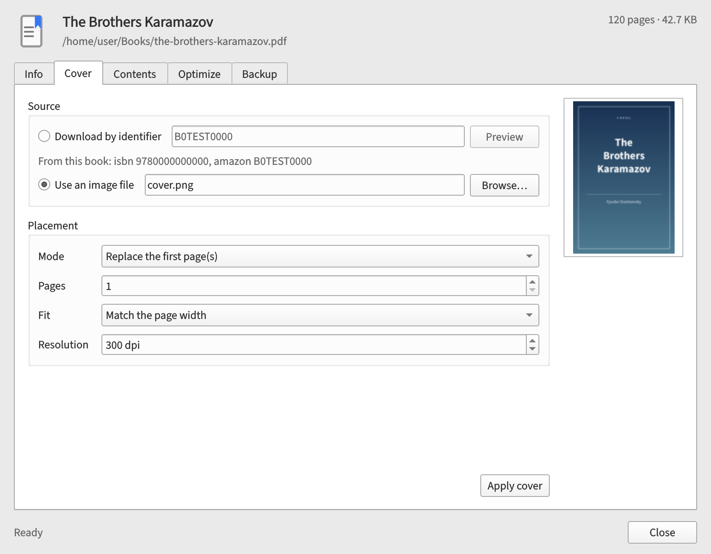
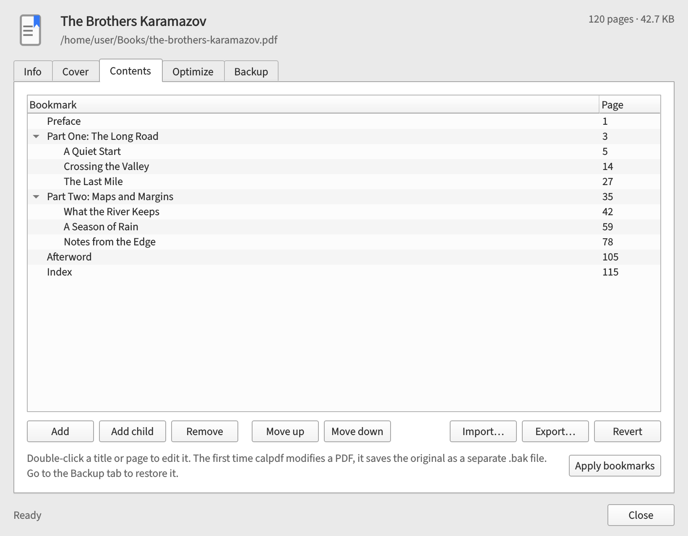

<div align="center">
  

# CalPDF

</div>

Hi. CalPDF puts [calpdf](https://github.com/athaurian/calpdf) inside Calibre.
You can replace covers, edit bookmarks, run `qpdf`, and restore backups,
exactly as you would on the command line.

It delegates all PDF handling to calpdf's own code instead of reimplementing it.

## Tabs

<p align="center">
  
</p>

The **Info** tab shows you the page count, page size, file size, PDF version, bookmark
count, and whether a backup exists. Nothing on this tab changes the file.

---

<p align="center">
  
</p>

The **Cover** tab lets you download a cover by ASIN or ISBN, or pick an image
from disk. You can replace the first page or prepend a new cover page, and you
see a preview before you apply it. Downloading a cover needs a network
connection and an ASIN or ISBN that the cover service knows about. The lookup
code is in [dlcover.py](https://github.com/athaurian/calpdf/blob/main/src/calpdf/dlcover.py).

---

<p align="center">
  
</p>

The **Contents** tab shows the PDF's outline as a tree. You can rename a title,
change its page, add or remove entries, and move them up or down. Import and
export use the same ToC JSON format as the `calpdf export-toc` and
`calpdf apply-toc` commands.

---

The **Optimize** tab runs `qpdf` on the PDF for you. It has two options
(both are off by default): (1) stripping ICC color profiles, and (2) **Keep the document
metadata**. With the second one off, you lose the title and author, so enable it
if you want to keep them. Note that optimizing usually makes a PDF smaller, but a file
that is already well optimized can grow a little, because `qpdf` adds
linearization data.

Finally, the **Backup** tab shows you the `.bak` copy calpdf keeps and lets you put it
back.

## Backup behavior

When you change anything for the first time, calpdf saves a `.bak` copy next to
the PDF and leaves it alone after that. A cover, a bookmark edit, and an
optimization all share that one backup. **Restore from backup** puts the copy
back over the PDF and deletes it, the same way `calpdf restore` does.

If you close the dialog without applying anything, the PDF is untouched.

## Prerequisites

- Calibre 6 or newer.
- [calpdf](https://github.com/athaurian/calpdf) 0.2 or newer, installed where
  Calibre can import it. If Calibre cannot find calpdf, the plugin tells you
  what is wrong.
- `qpdf` on `PATH` for the Optimize tab.

Calibre imports calpdf from the Python installation it runs on, so installing
calpdf using `uv tool install` will not help. On Arch, you can install
`calpdf-git` from my
[Forge repository](https://github.com/athaurian/forge), and it goes into the
system Python that Calibre uses. Elsewhere, install calpdf into the same Python
installation.

I use CalPDF on Linux. On Windows and macOS, Calibre bundles its own Python,
and I have not covered how to install calpdf into it yet.

## Install

```bash
git clone https://github.com/athaurian/calibre-calpdf.git
cd calibre-calpdf
make build
calibre-customize -a dist/calpdf.zip
```

Restart Calibre, then add the **CalPDF** button from
_Preferences → Interface → Toolbars & menus_. You can set a shortcut under
_Preferences → Shortcuts_.

To remove the plugin:

```bash
make uninstall
```

## Development

```bash
make venv     # uses the system calpdf, pikepdf, and Qt
make test
make lint
make ui       # renders docs/screenshots/*.png offscreen
```

The tests run against the checkout at `../calpdf/src`, not whatever copy of
calpdf you have installed. Point `CALPDF_SRC` elsewhere if your checkouts are
arranged differently.

`build.py` zips `calpdf_plugin/` with `plugin-import-name-calpdf.txt` at the
root. That file tells Calibre to load the plugin as `calibre_plugins.calpdf`.

## License

Released under the MIT license. See [LICENSE](LICENSE) for the full text.
